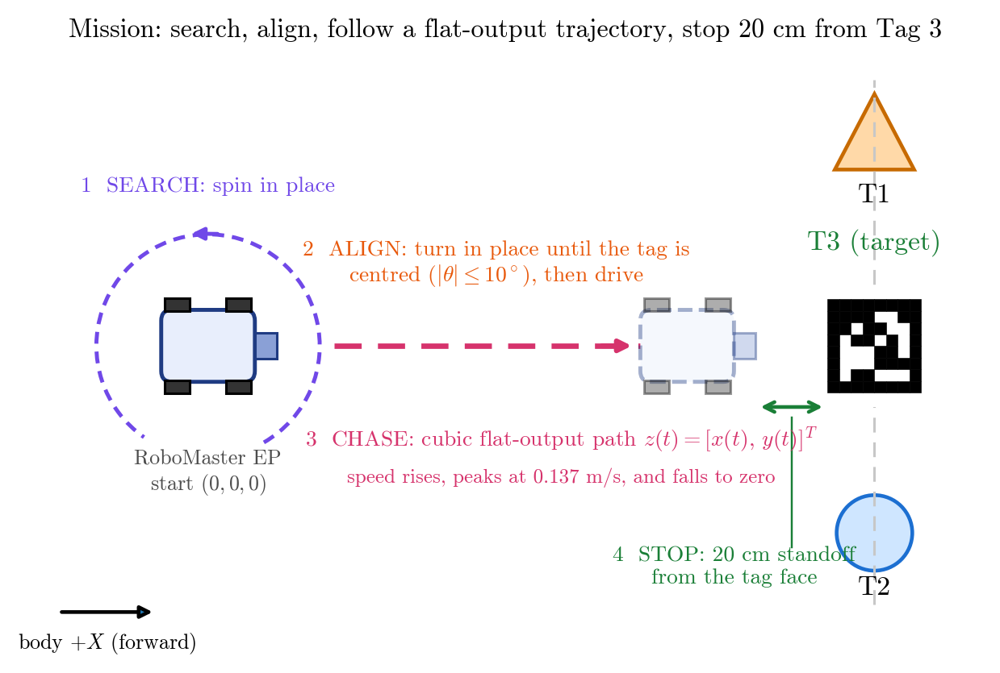

# RoboMaster EP: Advanced Robotics

Coursework for **SCE 672 Advanced Robotics** (KFUPM, Prof. Aamer Iqbal Bhatti) by **Ameen Ur Rehman (202527430)**.
Two assessments on a DJI **RoboMaster EP Core**: system provisioning with keyboard teleoperation and telemetry (Assessment 1), and an autonomous AprilTag search-and-chase using **differential flatness** with a motor-voltage model (Assessment 2).

<p align="center">
  
  <br><em>The robot and the three flat tags: start layout (1.5 m on the phone's measure tool) and after the autonomous stop.</em>
</p>

## What the robot does (Assessment 2)

1. **Search:** it turns on the spot until it sees AprilTag 3.
2. **Align:** it centres the tag in the camera.
3. **Chase:** it follows a smooth cubic path in the flat output `(x, y)`; speed and turn rate come from flatness inversion.
4. **Stop:** the planned path ends at 0.20 m from the tag. All four motor voltages return to 0 V.

<p align="center">
  
</p>

## What the robot sees

The robot's camera is fixed to its chassis and looks about 20 degrees down. Tags 1 and 2 are distractors; the node follows only ID 3.

<p align="center">
  
</p>

## Results

| | Assessment 1 | Assessment 2 |
|---|---|---|
| Link | wired USB (RNDIS) vs the robot's Wi-Fi AP | wired USB |
| Main numbers | ping 0.45 ms (USB) vs 28.3 ms (AP), 0% loss; telemetry interval 102.3 +/- 8.8 ms (USB) vs 120.2 +/- 52.3 ms (AP) | flat tags: search 8.0 s, align 2.0 s, chase about 8.9 s, peak 0.136 m/s, all voltages 0.000 V at the stop, about 20 cm from the tag |
| Reports | `Assignment 1/report/report.pdf` (27 pages) | `Assignment 2/report/report.pdf` (21 pages) |

<p align="center">
  
  <br><em>Final run: forward speed v(t) and motor voltage V1(t) (1 Hz log).</em>
</p>

Assessment 1 also reports odometry error against tape measurements (0.35 m, 2.4 % of the path, for the Wi-Fi run; 1.15 m, 29.9 %, for the USB run with strafing), the NumPy 2 ABI failure reproduced for real, the mecanum inverse and forward kinematics with a numerical check, the ROS 2 TF tree, and a ROS 2 bag with strafing.

<p align="center">
  
  
</p>

## Repository map

| Folder | What is in it |
|---|---|
| `Assignment 1/` | SDK teleop and telemetry script, environment loader, ping and telemetry analysis, ROS 2 bag and odometry plots, `report/` (LaTeX and PDF) |
| `Assignment 2/` | ROS 2 package `rm_flatness_nav`, logs of every run (including failed ones), figures, photos, `report/` (LaTeX and PDF) |
| `Tag/` | the three printable AprilTags (IDs 1, 2, 3), A4 at 100% scale |
| `Assets/` | the script that generates the tags and the mission figure |
| `Game/` | "RoboMaster Quest": a no-code browser game that explains the project to school students (open `Game/index.html`) |

## Quick start

Assessment 1 (SDK teleoperation, robot on USB):

```
source ~/rm_setup.sh
python "Assignment 1/ep_teleop_sdk.py" --conn rndis --duration 30 --out rndis_run.csv
```

Assessment 2 (build, test, run the chase):

```
cd "Assignment 2"
colcon build --symlink-install && source install/setup.bash
python -m pytest -q rm_flatness_nav/test
ros2 launch robomaster_ros ep.launch conn_type:=rndis
ros2 launch rm_flatness_nav flatness_nav.launch.py tag_id:=3 tag_size:=0.15 csv_path:=$PWD/motor_voltage_log.csv
```

`tag_size` is the measured side of the black square in **metres** (0.15, not 15). Print the tags from `Tag/` at 100% scale. See each assessment's own README for details.

## Honest notes

- The final run used the three printed tags lying flat. The start distance was 1.2 to 1.5 m (hand-measured range), below the assignment's 1.5 to 1.8 m, and the robot stopped about 20 cm from the tag.
- The log shows the stop came from the end of the planned trajectory (`ARRIVED (trajectory end, tag out of view)`, empty ToF column), not from a sensor reading.
- Motor voltages are model values computed from the commanded velocities, not measurements at the motors.
- The final run only has a 1 Hz log. Several failed attempts are kept in `Assignment 2/logs/` rather than hidden.

## Demonstration videos

- Assessment 1: <https://youtube.com/shorts/_sVQTNfv-6Q> and <https://youtube.com/shorts/8OImLpgchEI>
- Assessment 2: <https://youtu.be/EaZKQfd3usE> and <https://youtu.be/JlHnuVnLLrA>
